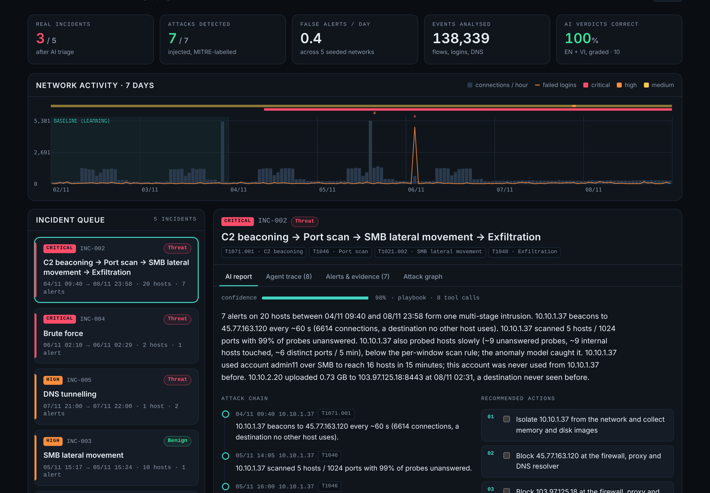

# NetSentinel · AI-assisted mini SOC

**Live demo:** https://vuthevinh2125.github.io/netsentinel/ · English / Tiếng Việt

NetSentinel watches a company network the way a small Security Operations Centre would: it learns how every host normally behaves, raises alerts from rules, an anomaly model and a beaconing detector, chains the alerts into incidents, and then an **AI analyst investigates each incident with read-only tools** and writes the report, including saying when an alert is a false alarm.

Everything runs on a reproducible lab: seven days of traffic from a simulated 54-host company with seven injected, MITRE ATT&CK-labelled attacks and several legitimate activities that look suspicious on purpose. That makes every number below checkable.



## Results

Five independently generated networks (seeds 7, 11, 23, 42, 99), seven attacks each, scored against the injected ground truth:

| Metric | Rules only | Model only | Rules + beaconing | **Hybrid** |
|---|---|---|---|---|
| Attacks detected | 71% | 57% | 86% | **100%** |
| Alert precision | 83% | 100% | 75% | **84%** |
| False alerts / day | 0.2 | 0 | 0.4 | **0.4** |
| A1 C2 beaconing | 0% | 0% | 100% | **100%** |
| A2 Port scan (fast) | 100% | 100% | 100% | **100%** |
| A3 Port scan (slow) | 0% | 100% | 0% | **100%** |
| A4 SSH brute force → success | 100% | 0% | 100% | **100%** |
| A5 Lateral movement over SMB | 100% | 100% | 100% | **100%** |
| A6 DNS tunnelling | 100% | 100% | 100% | **100%** |
| A7 Exfiltration | 100% | 0% | 100% | **100%** |

No single method is enough: rules miss the low-and-slow scan, the anomaly model misses brute force and a one-off large upload, and only the combination catches all seven. The remaining false alerts come from two deliberate traps (a monitoring agent's perfectly regular heartbeat and an admin's software push over SMB), and the AI analyst closes both as benign.

**AI analyst:** 10/10 correct verdicts (5 incidents × English and Vietnamese), graded on 7 checks per report: verdict, severity, every IOC named, MITRE looked up, investigation method, containment first, language.

## How it works

```
lab network ─► features per host / 5 min ─► rules ─┐
                                           ─► anomaly model (Isolation Forest on robust z-scores) ─┼─► alerts ─► incidents ─► AI analyst ─► report
flows · logins · DNS ──────────────────────► beaconing (inter-arrival regularity) ─┘        (pivot chaining)    (tool use)
```

| Layer | What it does | Where |
|---|---|---|
| Lab network | 54 hosts on 3 VLANs with office-hour behaviour. Attacks: C2 beaconing (T1071.001), fast and slow port scans (T1046), SSH brute force with success (T1110), SMB lateral movement with a stolen admin account (T1021.002), DNS tunnelling (T1071.004), exfiltration (T1048). Traps: authorised vulnerability scan, nightly 1.5 GB backup, admin software push, monitoring heartbeat, password typos, proxy-blocked sites. Attack intensity is randomised per seed. | `netsentinel/simulate.py` |
| Rules | Port scan, brute force (sliding 10-minute window, critical on success), SMB fan-out by an account from a host it never used, DNS tunnelling (length + entropy + uniqueness), large upload to a never-seen destination. Authorised scanners are suppressed with a reason. | `netsentinel/detect.py` |
| Anomaly model | Each host is compared with **its own** baseline (median / MAD robust z-scores on structural counts: distinct ports, unanswered probes, internal hosts touched, SMB peers, new external destinations, failed logins, long random DNS names), then scored by an Isolation Forest. An alert needs both an unusual score and a ≥6σ shift, so it can always say *why*. | `netsentinel/detect.py` |
| Beaconing | Many small connections to a rare external host with low jitter in the inter-arrival times. Behaviour that already existed during the baseline is kept out of attack chains. | `netsentinel/detect.py` |
| Incidents | Alerts are joined when they share a source, or when a later alert starts from a host an earlier alert touched and that host had no earlier alerts (a pivot). The phished workstation → database → exfiltration story becomes one incident. | `netsentinel/detect.py` |
| AI analyst | A Claude tool-use loop with six read-only tools (`get_incident`, `host_profile`, `query_flows`, `auth_events`, `dns_queries`, `lookup_mitre`) and a structured `submit_report`. A deterministic playbook analyst uses the same tools offline, so the pipeline works without an API key and gives a baseline to compare the LLM against. | `netsentinel/agent/` |
| Evaluation | Attack-level recall, alert precision and false alerts per day across seeds; seven checks per AI report. | `netsentinel/evaluate.py`, `netsentinel/agent/evals.py` |

## Run it

```bash
pip install -r requirements.txt
python -m pytest -q                         # 16 tests
python -m netsentinel compare               # the table above
python -m netsentinel run --seed 11         # new network, writes docs/data/demo.json
python -m netsentinel agent-eval            # grade the analyst
python web/app.py                           # live dashboard on http://localhost:8000/?seed=11
```

To let Claude write the reports instead of the playbook analyst:

```bash
export ANTHROPIC_API_KEY=sk-ant-...         # or NETSENTINEL_LLM_URL=https://your-proxy
python -m netsentinel agent-eval --analyst claude
```

The same seven checks grade both analysts, so the comparison is like for like.

## Honest limits

- The data is simulated. It is shaped like NetFlow, auth and DNS logs, and the detectors only use fields real collectors provide, but real networks are noisier. `simulate.py` is the place to plug in public datasets such as CIC-IDS2017.
- The playbook analyst is written for these seven attack types; its perfect score shows the harness works, not that it generalises. Generalising is the LLM analyst's job, and the eval exists to measure it.
- No real organisation's logs were used at any point.

## Tiếng Việt

NetSentinel là một SOC mini có AI:
- **Phát hiện:** luật, mô hình bất thường cho từng máy và bộ phát hiện beaconing cùng theo dõi lưu lượng, đăng nhập và DNS của một mạng doanh nghiệp mô phỏng 54 máy.
- **Gom sự cố:** các cảnh báo được nối thành chuỗi tấn công.
- **Điều tra:** một AI analyst dùng công cụ chỉ-đọc để điều tra từng sự cố, rồi viết báo cáo song ngữ và nêu rõ khi nào là báo động giả.

Trên 5 mạng sinh độc lập, cách kết hợp phát hiện **7/7** cuộc tấn công với **0,4** báo nhầm mỗi ngày. Toàn bộ dữ liệu là mô phỏng, không dùng log của tổ chức thật.

---

Built by **Vu The Vinh** · [Portfolio](https://vuthevinh2125.github.io/portfolio/) · MIT License
